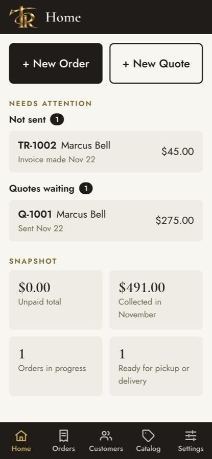
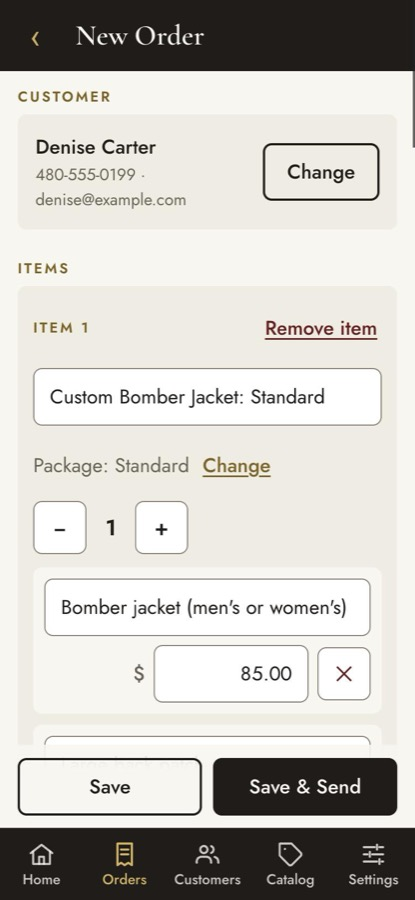
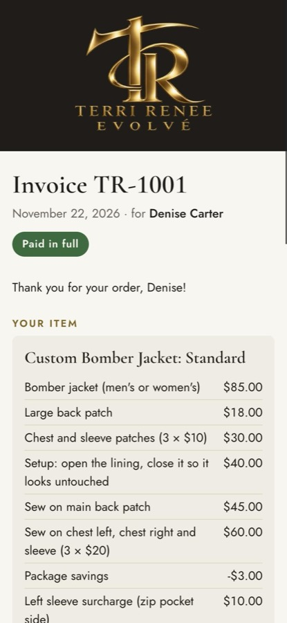
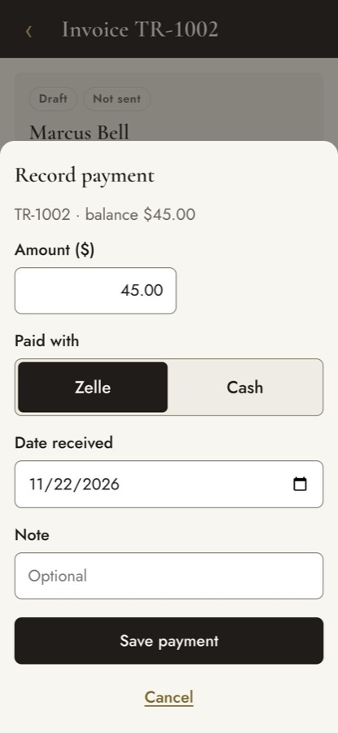
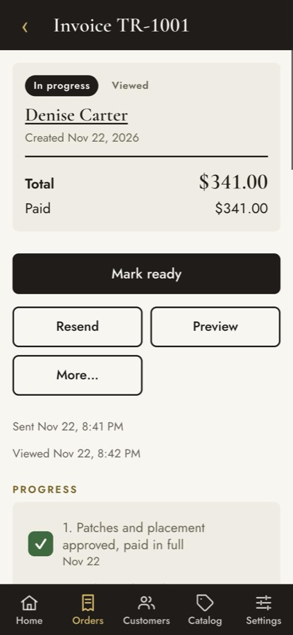

# TR Orders on your iPhone

A quick guide for Terri. Keep it handy for the first few orders.

---

## 1. Put TR Orders on your Home Screen (one time)

1. Open **Safari** (the blue compass). It has to be Safari.
2. Go to **terrireneedesigns.github.io/tr-orders**
3. Tap the **Share** button at the bottom: the square with an arrow pointing up.
4. Scroll down and tap **Add to Home Screen**. The name already says **TR Orders**. Tap **Add**.
5. Close Safari. From now on, open **TR Orders** from your Home Screen. It has the gold TR icon and opens full screen.

## 2. Unlock

Type the passcode and tap **Unlock**. You stay unlocked on this phone, so you won't need it again unless you sign out.

---

## 3. Home

- **+ New Order** makes an invoice. **+ New Quote** makes a quote the customer approves first.
- **Needs attention** lists anything waiting on you: not sent yet, unpaid and overdue, ready but not picked up, quotes waiting or about to expire. Tap a row to open it.
- **Snapshot** shows money still owed, money collected this month, and how many orders are in progress or ready.
- **Pull down** on any list to refresh it.

## 4. Make an order or quote

1. **Customer:** type a few letters of their name to find them, or tap **+ New**.
2. **+ Add item**, then pick the product and package (for jackets: Standard, Premium or Collector's). The prices fill in. You can change any line, delete it, or tap **+ Add line** / **+ Add-on**.
3. **Jacket details:** style, size, color, then the patch spots. Tap **Choose patch** and type the number or name. Set the sleeve to Left or Right (Left adds the $10 surcharge for you). **+ Extra patch spot** adds up to 3 extras.
4. Pickup or delivery, a ready date if you like, and any note for the customer.
5. Tap **Save & Send**, then **Send now**.

If the app closes while you're typing, open the order again and tap **Restore them**.

## 5. Send it

Tap **Send** (or **Send now**). Your iPhone's share menu opens with the message and link ready. Pick **Messages**, **Mail** or WhatsApp and send. When you come back, TR Orders asks **"Did you send it?"** Tap **Yes, sent**. If you tapped Not yet, it stays on your Needs attention list.

The customer opens the link and sees a page like this, with the Zelle QR code and their total:

When a customer approves a quote, it becomes an invoice on the spot, and you get an email at terrireneedesigns@gmail.com.

## 6. When they pay

Open the order and tap **Record payment**. The amount is already filled in. Choose **Zelle** or **Cash**, then **Save payment**. The order moves to **In progress**, and the app offers to **Send a receipt**.

## 7. While you work

- Tick each step under **Progress** as you go (jacket in, lining opened, patches sewn on...).
- When every item passes **Final check**, the app asks to **Mark ready** and offers to text the customer.
- When they pick it up, tap **Picked up** (or **Delivered**).
- **+ Add photo** (near the bottom) keeps reference photos with the order. Customers never see them.
- **More…** has Edit, Duplicate, Copy customer link, Cancel order and more.

---

## Good to know

- **Settings** has your business details, Zelle info, the words in your text messages, and the True Value Statement. You can change them anytime.
- **Updates** arrive by themselves. If you see "A new version is ready", tap **Refresh**.
- **Backups** happen every night. You can also tap **Back up now** in Settings.
- **Lost your phone?** On another phone or computer, open TR Orders, then go to **Settings → Sign out all devices**.
- **Stuck?** Close TR Orders fully (swipe up from the bottom and swipe it away) and open it again. Still stuck: call Autumn.
